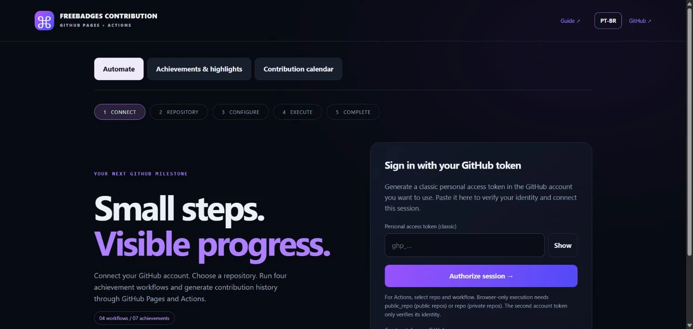

# Freebadges Contribution

**Run GitHub achievement workflows and generate labeled contribution history from your browser.**

[**Open the app**](https://brunnojob.github.io/freebadges-contribution-/) · [Step-by-step guide](https://brunnojob.github.io/freebadges-contribution-/guide/) · [Contribute](CONTRIBUTING.md)

[](https://github.com/brunnojob/freebadges-contribution-/actions/workflows/studio.yml) [](LICENSE)

[](https://brunnojob.github.io/freebadges-contribution-/)

**No installation.** Open the app, connect classic GitHub tokens from two different accounts, choose an owned repository and review the execution plan. For background Actions execution, select `repo` and `workflow` when creating the token. Choose the destination account before selecting its repository. For Pair, enter emails linked to both authenticated accounts; the app builds the `Co-authored-by` trailer automatically.

Four workflows: **Quickdraw · Pull Shark · Pair Extraordinaire · YOLO**. Seven achievement guides, live Starstruck milestone estimates, a contribution calendar and PT-BR / English support. Actions runs in your own private executor; direct-browser execution is also available.

GitHub controls badge eligibility and timing. Completed workflows confirm operations, not a guaranteed badge award. Synthetic contribution history is explicitly labeled.

## Quick start

[Open the hosted app](https://brunnojob.github.io/freebadges-contribution-/) — no installation required. Connect your classic token, choose your repository and review the workflow plan.

For contributors who want to run the interface locally, install Node.js 22+ and copy:

```sh
git clone https://github.com/brunnojob/freebadges-contribution-.git
cd freebadges-contribution-
npm run dev
```

Open the local URL printed in your terminal. Local preview is optional; the public app runs on GitHub Pages and executes background jobs through GitHub Actions.

## Use

1. Create an expiring classic PAT in each of two different GitHub accounts. For **Actions**, select `repo` and `workflow`. Browser-only execution needs `public_repo` for public repositories or `repo` for private ones.
2. Paste both tokens in the Pages application and authorize the session. Choose the destination account; the other account becomes its Pair co-author.
3. Select an owned, initialized, writable, non-fork repository. Quickdraw needs Issues enabled.
4. Choose Quickdraw, Pull Shark, Pair Extraordinaire and/or YOLO. For Pull Shark, choose the exact positive integer PR count. For Pair, enter the main author’s and co-author’s linked emails, then inspect the generated trailer. Emails are commit metadata and are public in public repositories; the app cannot verify their account association.
5. Review the plan and execution engine. **GitHub Actions** is the default. The alternative executes directly from the browser tab.
6. Execute and inspect operation evidence. Actions continues after the tab closes; the direct-browser option requires the tab to stay open.

## Execution engines

| Engine | Behavior |
| --- | --- |
| GitHub Actions | The app prepares an owned private `freebadges-actions-v3` executor repository, installs reviewed workflow code, encrypts account tokens and stores them as GitHub repository secrets. It dispatches an execution plan without credentials in workflow inputs. |
| Browser tab | The Pages app calls GitHub's API directly. No runner repository or Actions secrets are created. |

The Actions executor belongs to the visitor and uses **that account's Actions quota**. The site owner's Pro subscription does not provide an unlimited runner service to visitors.

Both tokens stay in browser memory until disconnect or tab closure; changing the destination account swaps their roles. Actions dispatch does not clear browser credentials, so another run can reuse the session. Actions mode additionally saves `CLASSIC_PAT` and, for Pair, `COAUTHOR_PAT` as encrypted secrets in the connected user's private executor. They are never stored in this public site repository, browser storage, workflow inputs, artifacts or application logs. The dashboard can remove the saved runner credentials after a completed execution. Tokens can also be revoked in GitHub settings. Closing the tab clears browser credentials; it does not remove Actions secrets or stop a submitted run.

Secret encryption uses self-hosted TweetNaCl and libsodium-compatible sealed boxes. The installer checks executor files and refuses changed code or additional workflows before sending credentials. Actions checks that the token account, execution-plan owner and dispatch actor match. Pair also verifies the expected secondary identity before changing the target repository. Workflow code and repository rules remain visible and enforced.

## Automated workflows

| Workflow | Operations |
| --- | --- |
| Quickdraw | Open an issue, close it immediately and verify the five-minute window. |
| Pull Shark | Create and merge the chosen number of PRs (default: 2) with labeled records under `.achievement-studio/`. |
| Pair Extraordinaire | Set the destination account as commit author and format the other authenticated account’s email as a `Co-authored-by` trailer and merge its PR. GitHub Desktop is optional. |
| YOLO | Merge a PR without reviews, optionally requesting an existing collaborator first. Refuse a PR that already has reviews. |

Combined selections reuse PRs: all four use one issue and the chosen Pull Shark PR count. Pair and YOLO share the first PR. PRs are paced sequentially; large batches remain subject to API limits, Actions quota and the 60-minute job timeout. Protected branches and required checks are never bypassed. Partial runs retain links for inspection. Stop in browser mode acts between requests; a just-opened Quickdraw issue is still closed. Actions cancellation is requested through GitHub and may take time; already-completed mutations remain.

**Completed operations do not verify a badge award.** GitHub evaluates eligibility and issues achievements separately. The app does not promise instant delivery or claim to read awarded badges through an API.

## Seven achievements and highlights

Guides cover Quickdraw, Pull Shark, Pair Extraordinaire, YOLO, Galaxy Brain, Starstruck and Public Sponsor. Only the first four are automated. Starstruck uses the maximum stars on one owned public non-fork repository, with documented milestones of 16 / 128 / 512 / 4,096. It never sums or generates stars.

Galaxy Brain needs accepted useful Q&A answers in eligible Discussions; achievements are disabled in GitHub's `community` organization. Public Sponsor requires GitHub Sponsors; external donations do not automatically qualify. Program highlights include Pro, Developer Program Member, Campus Expert, Security Bug Bounty Hunter, Security advisory credit and GitHub Star, with official links. Historical/experimental achievements are identified separately.

## Free Contributions

The online calendar previews and generates explicitly labeled synthetic history, through Actions or this browser tab. Choose UTC start/end dates through today and 1–20 commits/day, up to 1,500 commits/run. Requests are paced. A separate history branch preserves progress and only fast-forwards the default branch without force if it has not changed. Repeated runs add another batch.

GitHub graph eligibility depends on the account email, eligible branch/repository and private-contribution visibility. Processing may take up to 24 hours; exact green shades are not guaranteed. The original [Free Contributions](https://github.com/brunnojob/free-contributions) CLI remains under `vendor/free-contributions/` with its ISC license as an optional developer utility.

## Development

Node.js 22+, no npm dependencies to install:

```sh
npm test
npm run build
npm run dev
```

`docs/` is the Pages application; `docs/guide/` is the public walkthrough. `scripts/build-runner.mjs` packages the exact runner sources into `docs/js/runner-manifest.js`; CI checks that the packaged code matches reviewed sources. `scripts/actions-runner.mjs` is the background entry point. It exports a JSON operation report and a GitHub job summary without credentials. The executor workflow accepts only plan data and reads tokens from GitHub Secrets.

Tests cover API flows, private-executor validation, token-free dispatch inputs, account matching, run correlation, encryption interoperability, contribution planning and the original CLI in temporary Git repositories. They do not test actual badge awards. Existing Python/Ruby history auditors and the optional `cloud/sync.py` report archive are retained independently.

## License

Original code: [MIT](LICENSE). Free Contributions CLI: [ISC](vendor/free-contributions/LICENSE). Browser crypto dependencies retain their [licenses](docs/vendor/crypto/NOTICE.md). Maintained by [brunnodev.store](https://brunnodev.store).

If this saved you time, a star helps other developers find it.
